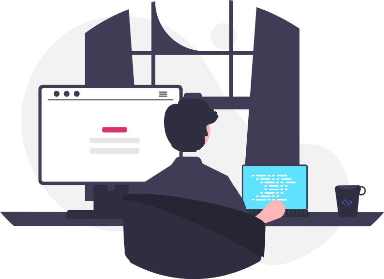

## 👋 About me

Computer Science graduate and Full-stack Developer, driven by curiosity and a hands-on approach to learning.

I started my journey in software development on the **back-end**, building APIs and learning how to structure reliable, maintainable systems. Over time, I expanded into **front-end** and **mobile**, which gave me a broader view of how products are built from end to end.

Today I enjoy working across the whole stack, from the user interface to business rules and data persistence, always focused on **clean code** and **good engineering practices**. I use **AI as a tool** to help me achieve both: reviewing and refactoring code, questioning design decisions and applying best practices, always supervising what it suggests.

 

## 🎯 Currently
 
**💻 Front-end & Back-end development**
- 🎨 Building web and mobile interfaces with **React** and **React Native**, focused on reusable components and a good user experience
- ⚙️ Developing back-end APIs with **Node.js/NestJS** and **Java/Spring Boot**, with **PostgreSQL**/**MySql**/**MongoDb**, authentication (JWT) and clean architecture
- 🤖 Using **AI-assisted development** (CLAUDE CODE, CODEX) to speed up the work, with every generated line **reviewed and supervised by me**: AI guides, I make the decisions
  
**☁️ DevOps & AWS**
- 🐳 Learning containers and delivery workflows with **Docker** and CI/CD
- 🟠 Studying core **AWS services**: **VPC**, **EC2**, **S3**, **DynamoDb**, **IAM**, **SQS**, **RDS**, **Lambda** and **CloudWatch**

 

## 🛠️ Tech stack

**Languages & Front-end**

**Back-end & Databases**

**DevOps & Cloud**

  

